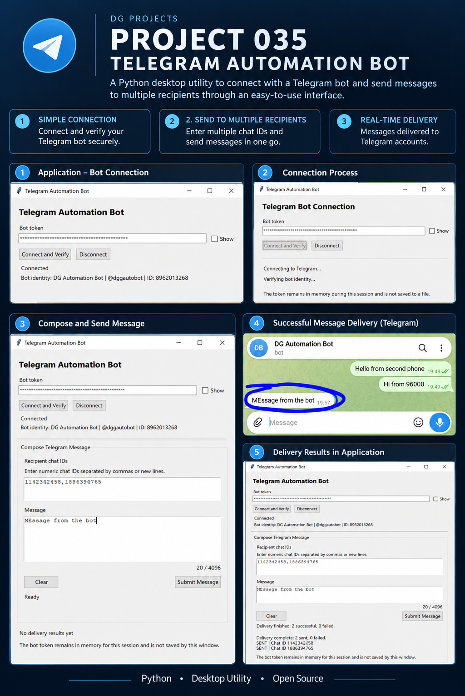
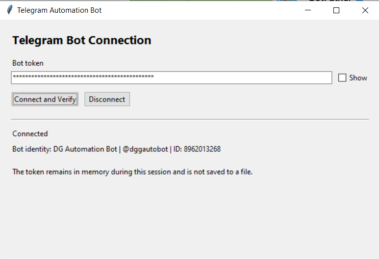
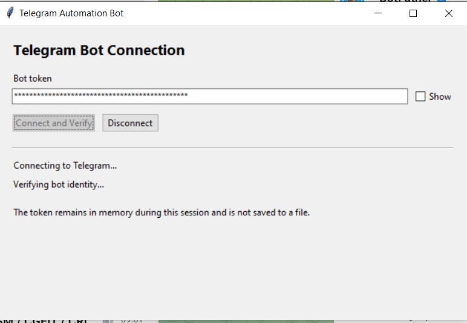
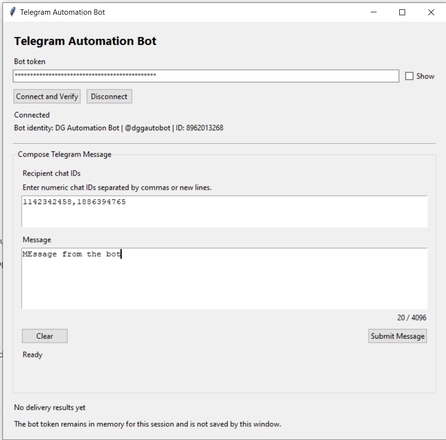
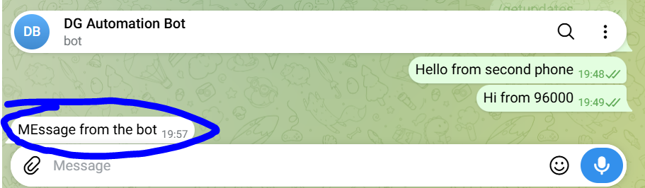
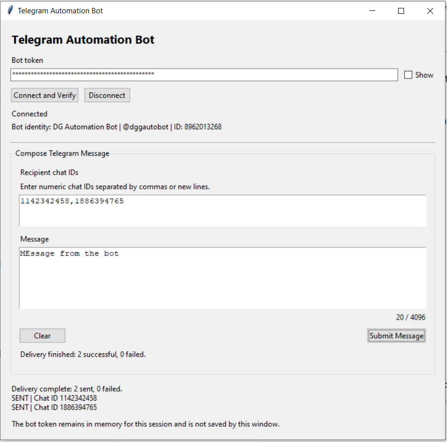

---

## 2. Project Badges


---

## 3. Screenshots

### Bot Identity Verified


### Bot Connection in Progress


### Compose a Message for Multiple Recipients


### Successful Message Received in Telegram


### Successful Delivery Confirmation in the Application


---

## 4. Project Title

# Project 035 — Telegram Automation Bot

---

## 5. Project Overview

Project 035 is a Python desktop application that connects to a Telegram bot through the Telegram Bot API and sends text messages to one or more configured Telegram chat IDs.

It provides a desktop interface for verifying the bot identity, composing a message, entering multiple recipient chat IDs, submitting the message, and reviewing delivery results.

**Problem solved:** It makes repeatable, multi-recipient Telegram message delivery available through a desktop workflow without requiring users to construct API requests manually.

**Typical use cases**
- Send a notification to several Telegram accounts.
- Deliver a test or operational message to known chat IDs.
- Verify bot connectivity before sending messages.
- Review per-recipient send outcomes in the application.

Recipients generally need to open the bot and press **Start** before the bot can send them private messages. The application sends outbound messages; automatic replies to incoming Telegram messages are outside the current MVP scope.

---

## 6. Features

- **Bot connection and verification:** Validates the supplied token and displays the bot identity returned by Telegram.
- **Session-only token handling:** The GUI indicates that the bot token remains in memory for the session and is not saved by the window.
- **Multiple recipients:** Accepts numeric chat IDs separated by commas or new lines.
- **Message composition:** Provides a text-entry area with a 4,096-character counter.
- **Multi-recipient delivery:** Submits the message to the entered recipients.
- **Delivery results:** Displays the delivery summary and individual recipient outcomes.
- **Connection controls:** Supports connecting, verifying, and disconnecting the bot session.
- **Automated tests:** Includes tests for configuration, execution reporting, notifications, recipients, Telegram connection, and sending.

---

## 7. Technology Stack

| Technology | Usage |
| --- | --- |
| Python | Application language |
| Telegram Bot API | Bot identity verification and message delivery |
| Tkinter / ttk | Desktop GUI |
| Python standard library | HTTP/JSON handling, file and path operations, logging, and supporting utilities where used |
| `unittest` | Automated tests |
| Git / GitHub | Source control and repository hosting, if configured for this repository |

No third-party runtime package is assumed here. Confirm `requirements.txt` and `pyproject.toml` before adding additional library badges.

---

## 8. Project Structure

```text
035 Telegram Automation Bot/
├── .github/
├── .gitignore
├── .vscode/
├── assets/
│   ├── fonts/
│   ├── icons/
│   ├── images/
│   └── templates/
├── data/
│   ├── input/
│   ├── output/
│   └── samples/
├── docs/
│   └── UserGuide.md
├── logs/
│   ├── application.log
│   └── execution_report.txt
├── releases/
│   ├── latest/
│   ├── v1.0/
│   └── v1.1/
├── screenshots/
│   ├── bot-verified.PNG
│   ├── configuring-telegram-bot.PNG
│   ├── confirmation-on-sending-message.PNG
│   ├── drafted-message.PNG
│   ├── poster.png
│   └── telegram-receiving-message-from-bot.PNG
├── src/
│   ├── config.py
│   ├── core/
│   ├── models/
│   │   ├── delivery_record.py
│   │   └── recipient.py
│   ├── services/
│   │   ├── delivery_record.py
│   │   ├── logging_service.py
│   │   ├── notification_service.py
│   │   ├── recipient_service.py
│   │   └── telegram_service.py
│   ├── ui/
│   │   ├── main_window.py
│   │   └── message_panel.py
│   └── utils/
├── tests/
│   ├── test_configuration.py
│   ├── test_execution_report.py
│   ├── test_notifications.py
│   ├── test_recipients.py
│   ├── test_telegram_connection.py
│   └── test_telegram_send.py
├── get_telegram_chat_id.py
├── LICENSE
├── main.py
├── pyproject.toml
├── README.md
└── requirements.txt
```

---

## 9. Module Overview

| Module | Responsibility |
| --- | --- |
| `main.py` | Application entry point that starts the desktop application. |
| `src/config.py` | Application configuration support. |
| `src/ui/` | Desktop interface, including the main window and message composition panel. |
| `src/services/` | Telegram API integration, recipient handling, notifications, delivery records, and logging services. |
| `src/models/` | Data models for recipients and delivery records. |
| `src/core/` | Directory exists; no Python source files were listed in the supplied tree. |
| `src/utils/` | Directory exists; no Python source files were listed in the supplied tree. |
| `tests/` | Automated tests for configuration, execution reporting, recipients, notifications, Telegram connection, and sending. |
| `get_telegram_chat_id.py` | Standalone diagnostic helper for checking pending Telegram updates and identifying chat IDs; not the main application entry point. |

---

## 10. Source Code Overview

The table includes every Python source file shown in the supplied repository tree exactly once.

| Source File | Purpose | Dependencies |
| --- | --- | --- |
| `main.py` | Starts the Telegram Automation Bot desktop application. | Project UI modules; Python standard library |
| `get_telegram_chat_id.py` | Checks the bot token, webhook status, and pending Telegram updates to help identify chat IDs. | `urllib`, `json`, `getpass` |
| `src/config.py` | Provides application configuration support. | Python standard library; project configuration dependencies |
| `src/models/recipient.py` | Represents a Telegram recipient and associated recipient data. | Model definitions; verify exact imports in source |
| `src/models/delivery_record.py` | Represents delivery outcome information. | Model definitions; verify exact imports in source |
| `src/services/delivery_record.py` | Provides delivery-record service functionality. | Delivery-record model and related project modules |
| `src/services/logging_service.py` | Handles application logging and execution-report support. | Python logging and file-handling facilities |
| `src/services/notification_service.py` | Coordinates message delivery through the Telegram service and tracks outcomes. | Telegram service, recipient and delivery-record modules |
| `src/services/recipient_service.py` | Parses, validates, and manages recipient chat IDs supplied to the application. | Recipient model; Python standard library |
| `src/services/telegram_service.py` | Communicates with Telegram's Bot API to verify bot identity and send messages. | Telegram Bot API; HTTP/JSON facilities used by the implementation |
| `src/ui/main_window.py` | Builds the main application window and connects the interface to application services. | Tkinter/ttk; project UI and service modules |
| `src/ui/message_panel.py` | Provides message composition, recipient entry, and send controls. | Tkinter/ttk; project service modules |
| `tests/test_configuration.py` | Tests application configuration behaviour. | `unittest`; configuration module |
| `tests/test_execution_report.py` | Tests execution-report behaviour. | `unittest`; logging/report module |
| `tests/test_notifications.py` | Tests notification orchestration and delivery handling. | `unittest`; notification and service modules |
| `tests/test_recipients.py` | Tests recipient parsing and validation. | `unittest`; recipient service and model |
| `tests/test_telegram_connection.py` | Tests Telegram bot connection and identity verification. | `unittest`; Telegram service |
| `tests/test_telegram_send.py` | Tests Telegram message-sending behaviour. | `unittest`; Telegram and notification services |

**Accuracy note:** The responsibilities above are based on the supplied folder tree and observed application behaviour. Confirm the exact imports and dependencies against each source file before treating this table as a complete dependency audit.

---

## 11. How to Run

### Prerequisites

- Windows with Python installed.
- A Telegram bot created through [BotFather](https://t.me/BotFather).
- The bot token.
- Numeric Telegram chat IDs for the intended recipients.
- Recipients should open the bot and press **Start** before receiving private messages.

### Run from source

Open PowerShell in the project root:

```powershell
cd "D:\ADGProjects\035 Telegram Automation Bot"
```

If `requirements.txt` declares dependencies, install them:

```powershell
python -m pip install -r requirements.txt
```

Start the application:

```powershell
python main.py
```

### Send a message

1. Enter the bot token in the application.
2. Select **Connect and Verify**.
3. Confirm that the bot identity is displayed.
4. Enter one or more numeric recipient chat IDs, separated by commas or new lines.
5. Compose the message.
6. Select **Submit Message**.
7. Review the delivery summary and per-recipient results.

Keep the bot token private. Do not commit it to source control or share it in screenshots, logs, or public issue reports.

---

## 12. How to Build

A PyInstaller build has not been confirmed by the supplied project evidence. If PyInstaller is selected and the application is validated for packaging, install it in the development environment:

```powershell
python -m pip install pyinstaller
```

A preliminary one-file, windowed build command is:

```powershell
python -m PyInstaller --noconfirm --clean --onefile --windowed --name TelegramAutomationBot main.py
```

Expected output locations:

- Executable: `dist\TelegramAutomationBot.exe`
- Build working files: `build\`

This is a proposed packaging command, not evidence that the executable has already been built or tested. Verify that PyInstaller can discover the application's imports and assets, then test the executable on a clean Windows environment before release. Add any required hidden imports or data files to the build configuration if needed.

---

## 13. Version

| Field | Value |
| --- | --- |
| Current Version | `1.1` — inferred from the repository's `releases/v1.1` folder; confirm against release metadata |
| Release Date | 13 October 2026 — documentation preparation date; replace if the actual release date differs |
| Status | MVP scope complete; direct Telegram delivery demonstrated. Packaged release status remains to be confirmed. |

**MVP scope:** Python-to-Telegram bot connection, bot identity verification, message composition, sending to multiple numeric chat IDs, and displaying delivery results.

**Excluded from this MVP:** automatic replies to incoming messages, scheduling, and additional workflow automation.

---

## 14. Development Workflow

```text
Requirements and MVP Scope
          |
          v
Application and UI Design
          |
          v
Implementation
          |
          v
Unit and Integration Tests
          |
          v
Manual Telegram Delivery Verification
          |
          v
Execution Report Review
          |
          v
Source Backup and Documentation
          |
          v
PyInstaller Packaging Validation
          |
          v
Git Tag and GitHub Release
```

Mark packaging and release steps complete only after the executable and release artifacts have been built and verified.

---

## 15. License

The project license is defined by the repository's `LICENSE` file. Review that file for the exact license terms before distributing the application.

If the repository uses the MIT License, the software may be used, copied, modified, published, distributed, sublicensed, and sold subject to the license conditions. The copyright and permission notice must be included in copies or substantial portions of the software, and the software is provided without warranty.

Confirm the actual license type from `LICENSE` and retain its complete text in the repository.
